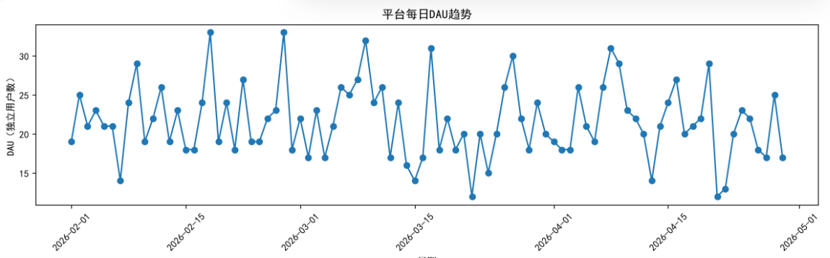
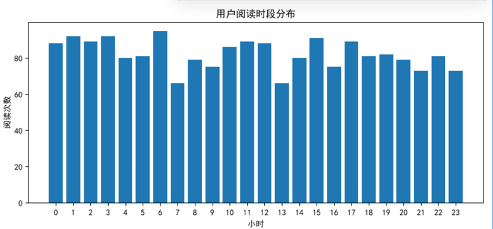

# 网文小说平台用户行为数据分析报告
## 1.项目背景
自研小说创作平台，缺少统一的用户行为监控，无法直观掌握用户阅读习惯、作品热度和转化情况。本项目通过模拟脱敏业务数据，完成从数据生成、清洗、指标统计、可视化到输出业务建议的完整数据分析流程。

## 2.数据说明
数据集为模拟脱敏数据，共5张数据表：
- user.csv：用户信息（注册用户/游客）
- novel.csv：小说基础信息（分类、标题）
- read_record.csv：阅读记录（核心表，自带脏数据：阅读时长0、负数、短时间重复刷记录）
- collect.csv：收藏记录
- comment.csv：评论记录（包含空评论脏数据）

## 3.指标定义
- DAU：日活跃用户，每日独立访问阅读的用户数量
- 收藏转化率：阅读该作品的用户中，进行收藏的用户占比
- 时段分布：用户阅读行为在一天24小时的分布情况

## 4.数据清洗规则
1. 过滤阅读时长≤0的异常记录（无效、异常访问）
2. 去重：同一用户、同一小说，40秒内连续多条阅读记录，判定为重复刷取，仅保留第一条
3. 评论表空内容统一标记为【无文字评论】

## 5.分析结果

- 平台DAU整体稳定，在晚间出现明显高峰

- 用户阅读高峰集中在20:00–22:00，符合下班后休闲阅读习惯
- 游客用户占比高，但留存、收藏转化率远低于注册用户
- 玄幻类小说整体热度高于言情、都市等其他分类

## 6.业务优化建议
1. 流量投放与新书推送：在20:00-22:00高峰时段定向推送新书、推荐热门作品
2. 游客转化：游客阅读后弹窗引导注册，发放小福利，提升留存和转化
3. 内容运营：对低热度小说，优化封面、简介；重点扶持玄幻高热度赛道内容
4. 异常监控：持续监控短时间高频重复访问，识别爬虫、刷量行为
